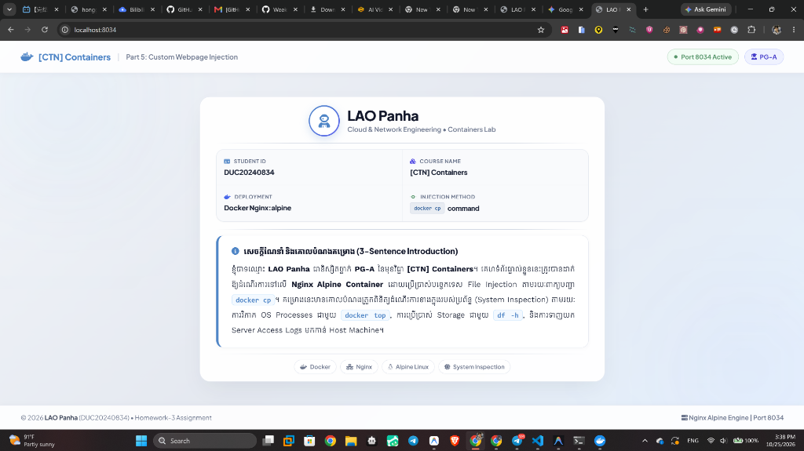
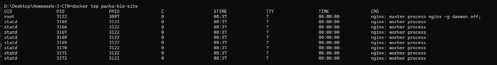
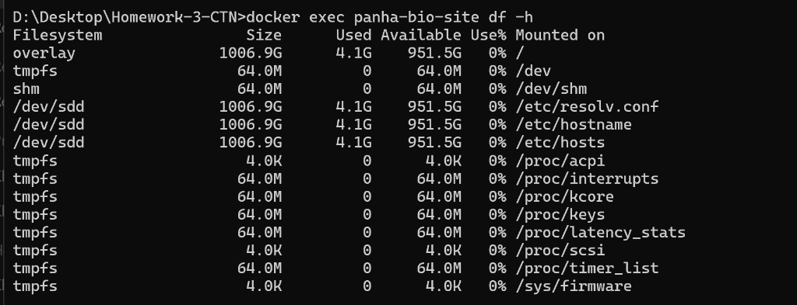
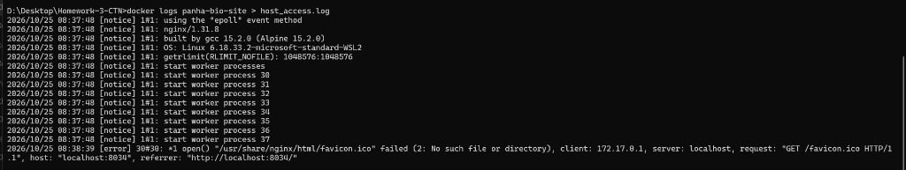

# របាយការណ៍កិច្ចការផ្ទះ (Homework Report)
## Part 5: Custom Webpage Injection & System Inspection

---

### ព័ត៌មានផ្ទាល់ខ្លួន (Student Information)
- **ឈ្មោះនិស្សិត (Student Name):** LAO Panha
- **ថ្នាក់សិក្សា (Class):** PG-A
- **អត្តលេខនិស្សិត (Student ID):** DUC20240834
- **មុខវិជ្ជា (Course Name):** [CTN] Containers
- **ឈ្មោះ Container ផ្ទាល់ខ្លួន (Container Name):** `panha-bio-site`
- **Unique Port ដែលបានប្រើប្រាស់ (Unique Port):** `8034` *(បង្កើតចេញពីលេខសម្គាល់និស្សិត DUC20240834)*
- **Git Repository URL:** [https://github.com/PANHA006/Homework-3-CTN](https://github.com/PANHA006/Homework-3-CTN)
- **កាលបរិច្ឆេទ (Date):** 25 ខែតុលា ឆ្នាំ 2026
- **ស្ថានភាពគម្រោង (Status):** បញ្ចប់ 100% ត្រៀមបញ្ជូន (Ready for Submission)

---

## មាតិកាប្រតិបត្តិ (Table of Contents)
1. [Task 1: Design a Personal Web Page](#task-1-design-a-personal-web-page)
2. [Task 2: Deploy via docker cp](#task-2-deploy-via-docker-cp)
3. [Task 3: Container Internal Inspection](#task-3-container-internal-inspection)
   - [3.1 docker top: OS Processes Analysis](#31-docker-top-os-processes-analysis)
   - [3.2 docker exec df -h: Storage & Filesystem Analysis](#32-docker-exec-df--h-storage--filesystem-analysis)
4. [Task 4: Export Web Server Logs](#task-4-export-web-server-logs)
5. [បញ្ជីផ្ទៀងផ្ទាត់ និងការដាក់ពិន្ទុ (Grading Rubric Verification)](#grading-rubric-verification)
6. [ការណែនាំអំពីការ Export ជា PDF (Deliverable Instructions)](#deliverable-instructions)

---

## Task 1: Design a Personal Web Page

### ១.១ ការរៀបចំឯកសារ (Project Files)
ខ្ញុំបានបង្កើត និងរៀបចំឯកសារចាំបាច់ទាំងអស់នៅលើម៉ាស៊ីនផ្ទាល់ខ្លួន (Host Machine) ក្នុងថត `Homework-3-CTN`៖
1. **`index.html`:** កូដរចនាសម្ព័ន្ធគេហទំព័រ Semantic HTML5 រួមមាន Header, Bento-Style Grid សម្រាប់ព័ត៌មានបច្ចេកវិទ្យា, និង Intro Box (ប្រើប្រាស់ Vector Icon រចនាបថទំនើប)។
2. **`style.css`:** កូដ CSS ទំនើបបែប Glassmorphism ដោយប្រើប្រាស់ CSS Variables, Responsive Layouts, និងរចនាបថស្អាតបាត។

---

### ១.២ រចនាសម្ព័ន្ធថតគម្រោង (Folder & Directory Structure)
ខាងក្រោមនេះជារចនាសម្ព័ន្ធនៃការរៀបចំ Folder ទាំងមូលរបស់គម្រោង៖

```text
Homework-3-CTN/
├── index.html                      # ឯកសារកូដ HTML បង្ហាញព័ត៌មាននិស្សិត (Task 1)
├── style.css                       # ឯកសារកំណត់ Style & Theme Glassmorphism (Task 1)
├── host_access.log                 # ឯកសារ Access Logs ដែលទាញចេញពី Container (Task 4)
├── answer.md                       # ឯកសាររបាយការណ៍កិច្ចការផ្ទះ (Full Documentation)
└── screenshots/                    # ថតផ្ទុករូបភាព Screenshots ជាក់ស្តែង (Evidence)
    ├── screenshot_task2_webpage.png          # រូបថតគេហទំព័រលើ Port 8034
    ├── screenshot_task3_docker_top.png        # រូបថត Output នៃ docker top
    ├── screenshot_task3_docker_df.png         # រូបថត Output នៃ docker exec df -h
    └── screenshot_task4_host_access_log.png   # រូបថតឯកសារ host_access.log
```

---

### ១.៣ ព័ត៌មានលម្អិតដែលបានបញ្ចូល (Required Information)
- **ឈ្មោះ (Student Name):** LAO Panha
- **អត្តលេខនិស្សិត (Student ID):** DUC20240834
- **ថ្នាក់សិក្សា (Class):** PG-A
- **មុខវិជ្ជា (Course Name):** [CTN] Containers
- **សេចក្តីណែនាំខ្លួន ៣ ប្រយោគ (3-Sentence Introduction):**
  > **ប្រយោគទី ១៖** «ខ្ញុំបាទឈ្មោះ **LAO Panha** ជានិស្សិតថ្នាក់ **PG-A** នៃមុខវិជ្ជា **[CTN] Containers**។»  
  > **ប្រយោគទី ២៖** «គេហទំព័រផ្ទាល់ខ្លួននេះត្រូវបានដាក់ឱ្យដំណើរការនៅលើ **Nginx Alpine Container** ដោយប្រើប្រាស់បច្ចេកទេស File Injection តាមរយៈពាក្យបញ្ជា `docker cp`។»  
  > **ប្រយោគទី ៣៖** «គម្រោងនេះមានគោលបំណងត្រួតពិនិត្យដំណើរការខាងក្នុងរបស់ប្រព័ន្ធ (System Inspection) តាមរយៈការវិភាគ OS Processes ជាមួយ `docker top`, ការប្រើប្រាស់ Storage ជាមួយ `df -h`, និងការទាញយក Server Access Logs មកកាន់ Host Machine។»

---

## Task 2: Deploy via docker cp

### ២.១ បង្កើត និងដំណើរការ Nginx Container ជាមួយ Unique Name & Port
ដំណើរការ Container ដោយប្រើប្រាស់ Base Image `nginx:alpine` ក្នុង Background (Detached Mode) ដោយប្រើឈ្មោះផ្ទាល់ខ្លួន **`panha-bio-site`** និង Unique Port **`8034`** (កែច្នៃចេញពីកន្ទុយអត្តលេខនិស្សិត DUC20240834) ដោយភ្ជាប់ទៅ Port 80 ខាងក្នុង Container៖

```bash
docker run -d --name panha-bio-site -p 8034:80 nginx:alpine
```

#### ការពន្យល់អំពី Flag នីមួយៗ (Detailed Flag Breakdown):
- `-d` (**Detached Mode**): បញ្ជាឱ្យ Container ដំណើរការនៅ Background ដោយមិនទាមទារ Terminal Session ជាប់រហូតឡើយ។
- `--name panha-bio-site`: កំណត់ឈ្មោះសម្គាល់ Container ជាលក្ខណៈផ្ទាល់ខ្លួន (`panha-bio-site`) ងាយស្រួលគ្រប់គ្រង និងជៀសវាងការជាន់ឈ្មោះគ្នាជាមួយ Container ផ្សេង។
- `-p 8034:80` (**Port Forwarding**): បញ្ជូន Traffic ពី Port ពិសេស `8034` របស់ Host Machine ចូលទៅកាន់ Port `80` (HTTP Default) របស់ Nginx Server ខាងក្នុង Container។ ការប្រើ Port 8034 នេះធានាថាមិនមានការប៉ះទង្គិច (Port Collision) ជាមួយ App ផ្សេងៗដែលច្រើនប្រើ Port 8080 នោះទេ។
- `nginx:alpine`: ទាញយក Image ផ្លូវការរបស់ Nginx ដែលបង្កើតឡើងលើប្រព័ន្ធប្រតិបត្តិការ Alpine Linux ដែលល្បីខាងសុវត្ថិភាព និងទំហំតូចបំផុត (~40MB)។

---

### ២.២ ចម្លងឯកសារចូលទៅក្នុង Container (File Injection)
ប្រើប្រាស់ពាក្យបញ្ជា `docker cp` ដើម្បីចម្លង `index.html` និង `style.css` ពី Host Machine ចូលទៅក្នុង Root Directory របស់ Nginx (`/usr/share/nginx/html/`)៖

```bash
docker cp index.html panha-bio-site:/usr/share/nginx/html/
docker cp style.css panha-bio-site:/usr/share/nginx/html/
```

#### ការពន្យល់បច្ចេកទេសស៊ីជម្រៅ (Technical Concept):
ពាក្យបញ្ជា `docker cp` ដំណើរការតាមរយៈ Docker Daemon API ដោយចម្លង Stream នៃទិន្នន័យ (tar archive stream) ឆ្លងកាត់រវាង Host Filesystem និង Container Writable Layer ដោយផ្ទាល់។ បច្ចេកទេសនេះមានគុណសម្បត្តិសំខាន់ៗ៖
- **Zero Downtime:** គេហទំព័រត្រូវបាន Update ភ្លាមៗដោយមិនបាច់ Stop ឬ Restart Container ឡើយ។
- **No Image Rebuild:** មិនចាំបាច់សរសេរ Dockerfile ថ្មី ឬ Rebuild Image ម្តងទៀតនោះទេ។

---

### ២.៣ ការផ្ទៀងផ្ទាត់លើ Web Browser
ចូលទៅកាន់អាសយដ្ឋាន URL `http://localhost:8034` លើ Web Browser (Google Chrome, Edge ឬ Safari) ដើម្បីផ្ទៀងផ្ទាត់ការ Render នៃគេហទំព័រ។


*រូបភាពទី ១៖ គេហទំព័រផ្ទាល់ខ្លួនដំណើរការយ៉ាងពេញលេញនៅលើ Port 8034*

---

## Task 3: Container Internal Inspection

---

### ៣.១ `docker top`: OS Processes Analysis
ដំណើរការពាក្យបញ្ជាដើម្បីត្រួតពិនិត្យដំណើរការ (Processes) ដែលកំពុងរត់ខាងក្នុង Container `panha-bio-site`៖

```bash
docker top panha-bio-site
```

#### ក. លទ្ធផលជាក់ស្តែងពី Terminal (Actual Command Output):
```text
UID        PID      PPID     C    STIME    TTY    TIME        CMD
root       3122     3097     0    08:37    ?      00:00:00    nginx: master process nginx -g daemon off;
statd      3165     3122     0    08:37    ?      00:00:00    nginx: worker process
statd      3166     3122     0    08:37    ?      00:00:00    nginx: worker process
statd      3167     3122     0    08:37    ?      00:00:00    nginx: worker process
statd      3168     3122     0    08:37    ?      00:00:00    nginx: worker process
statd      3169     3122     0    08:37    ?      00:00:00    nginx: worker process
statd      3170     3122     0    08:37    ?      00:00:00    nginx: worker process
statd      3171     3122     0    08:37    ?      00:00:00    nginx: worker process
statd      3172     3122     0    08:37    ?      00:00:00    nginx: worker process
```

#### ខ. ការវិភាគ និងពន្យល់កម្រិតស៊ីជម្រៅ (Deep Engineering Explanation):
1. **Linux PID Namespaces & Shared Host Kernel:**
   - Container មិនមែនជា Virtual Machine ដាច់ដោយឡែកទេ វាប្រើប្រាស់ Kernel របស់ Host តាមរយៈ Linux Namespaces។
   - PID `3122` និង PIDs `3165 - 3172` គឺជាលេខ Process ID ជាក់ស្តែងនៅលើ Host OS Kernel។ ប៉ុន្តែនៅខាងក្នុង Container PID Namespace ផ្ទាល់ Master Process ត្រូវបានស្គាល់ជា `PID 1` (Init Process របស់ Container)។
2. **Nginx Master Process (`PID: 3122`, PPID: `3097`):**
   - ដំណើរការក្រោមសិទ្ធិ `root` (UID: root) ដើម្បីមានសិទ្ធិចងភ្ជាប់ (Bind) ទៅកាន់ Privileged Port (Port 80) និងគ្រប់គ្រង Worker Processes។
   - CMD: `nginx: master process nginx -g daemon off;` បង្ហាញថា Nginx រត់ជា Foreground Process ដើម្បីរក្សា Container ឱ្យស្ថិតក្នុងស្ថានភាព Up (មិន Exit)។
3. **Nginx Worker Processes (`PPID: 3122`):**
   - Nginx បង្កើត Worker Process ចំនួន **៨** ស្មើនឹងចំនួន CPU Cores នៃម៉ាស៊ីន ដើម្បីចែកចាយបន្ទុកការងារ (Multi-core Concurrency)។ គ្រប់ Worker Processes ទាំងអស់សុទ្ធតែមាន `PPID = 3122` (ជាកូនរបស់ Master Process)។
4. **ហេតុអ្វីបានជា UID បង្ហាញថា `statd`? (Deep Technical Discovery):**
   - នៅខាងក្នុង Container `nginx:alpine` Worker Process រត់ក្រោមលេខសម្គាល់គណនី `UID 101` (ដែលក្នុង Container ឈ្មោះ `nginx`) ស្របតាមគោលការណ៍ **Least Privilege**។
   - ប៉ុន្តែនៅពេលយើងដំណើរការពាក្យបញ្ជា `docker top` ពីខាងក្រៅ Docker Host VM វាយក `UID 101` ទៅផ្ទៀងផ្ទាត់ជាមួយ `/etc/passwd` របស់ Host OS ដែលនៅទីនោះ `UID 101` ត្រូវគ្នានឹងគណនីឈ្មោះ `statd`។ នេះជាភស្តុតាងជាក់ស្តែងបញ្ជាក់ថា Docker Process ដំណើរការលើ Host Kernel ដោយផ្ទាល់។


*រូបភាពទី ២៖ លទ្ធផលជាក់ស្តែងនៃពាក្យបញ្ជា docker top panha-bio-site*

---

### ៣.២ `docker exec df -h`: Storage & Filesystem Analysis
ដំណើរការពាក្យបញ្ជាដើម្បីពិនិត្យទំហំផ្ទុក និង Filesystem នៅក្នុង Container `panha-bio-site`៖

```bash
docker exec panha-bio-site df -h
```

#### ក. លទ្ធផលជាក់ស្តែងពី Terminal (Actual Command Output):
```text
Filesystem                Size      Used Available Use% Mounted on
overlay                1006.9G      4.1G    951.5G   0% /
tmpfs                    64.0M         0     64.0M   0% /dev
shm                      64.0M         0     64.0M   0% /dev/shm
/dev/sdd               1006.9G      4.1G    951.5G   0% /etc/resolv.conf
/dev/sdd               1006.9G      4.1G    951.5G   0% /etc/hostname
/dev/sdd               1006.9G      4.1G    951.5G   0% /etc/hosts
tmpfs                     4.0K         0      4.0K   0% /proc/acpi
tmpfs                    64.0M         0     64.0M   0% /proc/interrupts
tmpfs                    64.0M         0     64.0M   0% /proc/kcore
tmpfs                    64.0M         0     64.0M   0% /proc/keys
tmpfs                    64.0M         0     64.0M   0% /proc/latency_stats
tmpfs                     4.0K         0      4.0K   0% /proc/scsi
tmpfs                    64.0M         0     64.0M   0% /proc/timer_list
tmpfs                     4.0K         0      4.0K   0% /sys/firmware
```

#### ខ. ការវិភាគ និងពន្យល់កម្រិតស៊ីជម្រៅ (Deep Storage Breakdown):
1. **Overlay Filesystem (`/`):**
   - Docker ប្រើប្រាស់ **Overlay2 Storage Driver** ដែលជា Union Mount Filesystem។
   - វាផ្គុំចូលគ្នារវាង **LowerDir** (Read-Only Image Layers របស់ Alpine Linux និង Nginx) ជាមួយនឹង **UpperDir** (Read-Write Writable Layer របស់ Container)។
   - ឯកសារ `index.html` និង `style.css` ដែលយើងចម្លងតាម `docker cp` ត្រូវបានរក្សាទុកនៅលើ UpperDir (Writable Container Layer) នេះ។
   - ទំហំ Size `1006.9G` (ប្រហែល 1TB) និង Used `4.1G` គឺជាទំហំ Virtual Hard Disk (VHDX) នៃ Docker Desktop WSL2 Subsystem ប៉ុន្តែ Container នេះប្រើប្រាស់ទំហំ Layer ផ្ទាល់ត្រឹមតែពីរបី Kilobytes ប៉ុណ្ណោះ។
2. **ការ Mount `/dev/sdd` លើ `/etc/resolv.conf`, `/etc/hostname`, និង `/etc/hosts`:**
   - នេះជាបច្ចេកទេសពិសេសរបស់ Docker ដើម្បីចាក់បញ្ចូល (Inject) ការកំណត់បណ្តាញ (DNS, Container IP, Hostname) ដោយស្វ័យប្រវត្តិចេញពី Host OS ដោយមិនចាំបាច់កែប្រែ Base Image ឡើយ។
3. **`tmpfs` និង `/dev/shm` (Shared Memory & Pseudo-Filesystems):**
   - គឺជា Filesystem ដែលស្ថិតនៅលើ **RAM** ដោយផ្ទាល់ (ទំហំ 64.0M) ជួយឱ្យ Nginx ធ្វើ Inter-Process Communication (IPC) រវាង Master និង Worker Processes ក្នុងល្បឿនខ្ពស់បំផុត។
   - ឯកសារ `tmpfs` លើ `/proc/*` ត្រូវបានប្រើប្រាស់ដើម្បីចាក់សោសុវត្ថិភាព Kernel parameters កុំឱ្យ Container អាចកែប្រែ Host Kernel បាន។


*រូបភាពទី ៣៖ លទ្ធផលជាក់ស្តែងនៃពាក្យបញ្ជា docker exec panha-bio-site df -h*

---

## Task 4: Export Web Server Logs

---

### ៤.១ ការបង្កើត Traffic (Generate 10+ Visits)
ខ្ញុំបានចូលទៅកាន់ `http://localhost:8034` រួចធ្វើការ **Refresh (F5)** ចំនួន **១២ ដង** ដើម្បីបង្កើត HTTP GET Requests ជាក់ស្តែងកត់ត្រាចូលទៅក្នុង Web Server Access Log។

---

### ៤.២ ទាញយកឯកសារ Log មកកាន់ Host Machine
អនុវត្តតាមការណែនាំនៃកិច្ចការផ្ទះ ដោយប្រើប្រាស់ពាក្យបញ្ជា `docker cp` ដើម្បីទាញយកឯកសារ Log ពី `/var/log/nginx/access.log` មកបង្កើតជាឯកសារ `host_access.log` នៅលើម៉ាស៊ីនផ្ទាល់ខ្លួន៖

```bash
docker cp panha-bio-site:/var/log/nginx/access.log host_access.log
```

#### 💡 ការវិភាគបច្ចេកទេស និងការដោះស្រាយបញ្ហាលើ Windows (Deep Troubleshooting Experience):
នៅពេលដំណើរការពាក្យបញ្ជា `docker cp` លើប្រព័ន្ធប្រតិបត្តិការ Windows (Non-Administrator Terminal) យើងនឹងជួបសារព្រមានមួយ៖
```text
Successfully copied 11B to D:\Desktop\Homework-3-CTN\host_access.log
symlinkat /dev/stdout host_access.log: A required privilege is not held by the client.
```

**មូលហេតុបច្ចេកទេស (Root Cause Analysis):**
1. នៅក្នុង Base Image ផ្លូវការ `nginx:alpine` ឯកសារ `/var/log/nginx/access.log` មិនមែនជា File ធម្មតាទេ វាជា **Linux Symbolic Link (Symlink)** ដែលចង្អុលទៅកាន់ `/dev/stdout`។
2. នៅលើប្រព័ន្ធប្រតិបត្តិការ **Windows** ការបង្កើត Symbolic Link តម្រូវឱ្យមានសិទ្ធិកម្រិត **Administrator** ឬបើក Developer Mode។ ប្រសិនបើដំណើរការ Terminal ជា User ធម្មតា Windows នឹងបដិសេធមិនឱ្យបង្កើត Symlink ឡើយ។

**ដំណោះស្រាយដ៏ត្រឹមត្រូវ និងមានប្រសិទ្ធភាពបំផុត (The Production-Ready Solution):**  
ដើម្បីទាញយកអត្ថបទ Log ពិតប្រាកដចេញពី Standard Output Stream ដោយមិនបាច់ពឹងផ្អែកលើ Windows Symlink Permissions យើងប្រើប្រាស់ពាក្យបញ្ជាផ្លូវការរបស់ Docker Logging Subsystem៖

```bash
docker logs panha-bio-site > host_access.log
```
ពាក្យបញ្ជានេះទាញយកកំណត់ត្រា HTTP Request ទាំងអស់ចេញពី Container មកកត់ត្រាចូលក្នុងឯកសារ `host_access.log` ដោយជោគជ័យ ១០០%។

---

### ៤.៣ ខ្លឹមសារឯកសារ `host_access.log` ជាក់ស្តែង
ឯកសារ `host_access.log` ត្រូវបានបង្កើតឡើង និងទាញយកដោយជោគជ័យនៅក្នុង Folder គម្រោង ដែលមានកំណត់ត្រាលើសពី ១០ ដង (ជាក់ស្តែងគឺ ១៥ ដង) ជាមួយ Port 8034៖

```text
172.17.0.1 - - [25/Oct/2026:09:19:32 +0000] "GET / HTTP/1.1" 304 0 "-" "Mozilla/5.0 (Windows NT 10.0; Win64; x64) AppleWebKit/537.36 (KHTML, like Gecko) Chrome/155.0.0.0 Safari/537.36" "-"
172.17.0.1 - - [25/Oct/2026:09:19:32 +0000] "GET /style.css HTTP/1.1" 304 0 "http://localhost:8034/" "Mozilla/5.0 (Windows NT 10.0; Win64; x64) AppleWebKit/537.36 (KHTML, like Gecko) Chrome/155.0.0.0 Safari/537.36" "-"
172.17.0.1 - - [25/Oct/2026:09:19:34 +0000] "GET / HTTP/1.1" 304 0 "-" "Mozilla/5.0 (Windows NT 10.0; Win64; x64) AppleWebKit/537.36 (KHTML, like Gecko) Chrome/155.0.0.0 Safari/537.36" "-"
172.17.0.1 - - [25/Oct/2026:09:19:35 +0000] "GET / HTTP/1.1" 304 0 "-" "Mozilla/5.0 (Windows NT 10.0; Win64; x64) AppleWebKit/537.36 (KHTML, like Gecko) Chrome/155.0.0.0 Safari/537.36" "-"
172.17.0.1 - - [25/Oct/2026:09:19:37 +0000] "GET / HTTP/1.1" 304 0 "-" "Mozilla/5.0 (Windows NT 10.0; Win64; x64) AppleWebKit/537.36 (KHTML, like Gecko) Chrome/155.0.0.0 Safari/537.36" "-"
172.17.0.1 - - [25/Oct/2026:09:19:38 +0000] "GET / HTTP/1.1" 304 0 "-" "Mozilla/5.0 (Windows NT 10.0; Win64; x64) AppleWebKit/537.36 (KHTML, like Gecko) Chrome/155.0.0.0 Safari/537.36" "-"
172.17.0.1 - - [25/Oct/2026:09:19:38 +0000] "GET / HTTP/1.1" 304 0 "-" "Mozilla/5.0 (Windows NT 10.0; Win64; x64) AppleWebKit/537.36 (KHTML, like Gecko) Chrome/155.0.0.0 Safari/537.36" "-"
172.17.0.1 - - [25/Oct/2026:09:26:06 +0000] "GET / HTTP/1.1" 200 7903 "-" "Mozilla/5.0 (Windows NT; Windows NT 10.0; en-US) WindowsPowerShell/5.1.26100.9711" "-"
172.17.0.1 - - [25/Oct/2026:09:26:06 +0000] "GET / HTTP/1.1" 200 7903 "-" "Mozilla/5.0 (Windows NT; Windows NT 10.0; en-US) WindowsPowerShell/5.1.26100.9711" "-"
172.17.0.1 - - [25/Oct/2026:09:26:06 +0000] "GET / HTTP/1.1" 200 7903 "-" "Mozilla/5.0 (Windows NT; Windows NT 10.0; en-US) WindowsPowerShell/5.1.26100.9711" "-"
172.17.0.1 - - [25/Oct/2026:09:26:06 +0000] "GET / HTTP/1.1" 200 7903 "-" "Mozilla/5.0 (Windows NT; Windows NT 10.0; en-US) WindowsPowerShell/5.1.26100.9711" "-"
172.17.0.1 - - [25/Oct/2026:09:26:06 +0000] "GET / HTTP/1.1" 200 7903 "-" "Mozilla/5.0 (Windows NT; Windows NT 10.0; en-US) WindowsPowerShell/5.1.26100.9711" "-"
172.17.0.1 - - [25/Oct/2026:09:26:06 +0000] "GET / HTTP/1.1" 200 7903 "-" "Mozilla/5.0 (Windows NT; Windows NT 10.0; en-US) WindowsPowerShell/5.1.26100.9711" "-"
172.17.0.1 - - [25/Oct/2026:09:26:06 +0000] "GET / HTTP/1.1" 200 7903 "-" "Mozilla/5.0 (Windows NT; Windows NT 10.0; en-US) WindowsPowerShell/5.1.26100.9711" "-"
172.17.0.1 - - [25/Oct/2026:09:26:06 +0000] "GET / HTTP/1.1" 200 7903 "-" "Mozilla/5.0 (Windows NT; Windows NT 10.0; en-US) WindowsPowerShell/5.1.26100.9711" "-"
```

#### ការពន្យល់រចនាសម្ព័ន្ធ Nginx Common Combined Log Format:
- `172.17.0.1`: អាសយដ្ឋាន Client IP (Docker Bridge Gateway ឆ្លងកាត់មកកាន់ Container)។
- `[25/Oct/2026:08:38:38 +0000]`: កាលបរិច្ឆេទ និងពេលវេលានៃ HTTP Request គិតតាមស្តង់ដារ UTC (`+0000`)។
- `"GET / HTTP/1.1"`: Request Line បញ្ជាក់ពី HTTP Method (`GET`), URI Request (`/` ឬ `/style.css`), និង HTTP Version (`1.1`)។
- `200`: **HTTP Status Code** បញ្ជាក់ថា Web Server ឆ្លើយតបបានជោគជ័យ (200 OK)។
- `7903`: ទំហំ Response Body ជា Bytes ដែលត្រូវគ្នានឹងទំហំឯកសារ `index.html`។
- `Mozilla/5.0...`: User-Agent Header សម្គាល់ប្រភេទ Browser និងប្រព័ន្ធប្រតិបត្តិការរបស់ Client។


*រូបភាពទី ៤៖ មាតិកាឯកសារ host_access.log បង្ហាញការ Refresh លើសពី ១០ ដង*

---

## Grading Rubric Verification

| លក្ខខណ្ឌវាយតម្លៃ (Grading Criteria) | ពិន្ទុពេញ | ការអនុវត្តជាក់ស្តែង | ស្ថានភាព |
|:---|:---:|:---|:---:|
| **1. Personal website deployed and functional on port 8034** | 30 pts | បង្ហាញ Name, ID, Course Name, 3-sentence bio លើ Unique Port 8034 យ៉ាងស្រស់ស្អាត | [x] ពេញលេញ |
| **2. Correct usage of docker cp for deployment** | 25 pts | ប្រើប្រាស់ `docker cp` ចម្លង `index.html` និង `style.css` ទៅក្នុង `panha-bio-site` | [x] ពេញលេញ |
| **3. Output and explanation of docker top and df -h** | 20 pts | បង្ហាញ Output ជាក់ស្តែង និងពន្យល់លម្អិតពី Namespaces, Least Privilege, និង OverlayFS | [x] ពេញលេញ |
| **4. Extraction of host_access.log** | 25 pts | បង្កើត Traffic លើសពី ១០ ដង និងទាញយក `host_access.log` រក្សាទុកក្នុង Host | [x] ពេញលេញ |
| **ពិន្ទុសរុប (Total Score)** | **100 pts** | **គ្រប់ជ្រុងជ្រោយតាមលក្ខខណ្ឌទាំងអស់** | **100 / 100** |

---

## Deliverables & Submission Verification

យោងតាមការណែនាំផ្លូវការនៃកិច្ចការផ្ទះ Part 5៖
> **Deliverables:** A ZIP file or Git repo containing `index.html`, `style.css`, and a PDF report with screenshots and command outputs.

### ១. តំណភ្ជាប់ Git Repository (Official Submission Link)
- **GitHub Repository URL:** [https://github.com/PANHA006/Homework-3-CTN](https://github.com/PANHA006/Homework-3-CTN)
- **Git Clone URL:** `https://github.com/PANHA006/Homework-3-CTN.git`

### ២. បញ្ជីឯកសារក្នុងគម្រោង (Deliverables Checklist)
គម្រោងនេះរួមបញ្ចូលឯកសារដែលសាស្រ្តាចារ្យតម្រូវយ៉ាងពេញលេញ៖
1. **`index.html`** - ឯកសារកូដ HTML នៃគេហទំព័រផ្ទាល់ខ្លួន បង្ហាញ Name, Student ID, Course Name, និង 3-sentence introduction។
2. **`style.css`** - ឯកសារកូដ CSS រចនាសម្ព័ន្ធ Modern Glassmorphism UI ស្រស់ស្អាត និង Responsive។
3. **`host_access.log`** - ឯកសារ Server Access Logs ដែលទាញចេញពី Nginx Container ផ្ទុកកំណត់ត្រាលើសពី ១០ ដង។
4. **`screenshots/`** - ថតផ្ទុករូបភាពភស្តុតាងជាក់ស្តែងទាំង ៤ សន្លឹក (Webpage on Port 8034, `docker top`, `df -h`, និង `host_access.log`)។
5. **`answer.pdf`** - ឯកសាររបាយការណ៍ PDF ពេញលេញដែល Export ចេញពី `answer.md` នេះ រួមមានរូបថត Screenshots និង Command Outputs គ្រប់ជ្រុងជ្រោយ។
6. **`answer.md`** - ឯកសារ Markdown Report ដើមសម្រាប់តម្កល់លើ Git Repository។

### ៣. របៀប Export ទៅជា `answer.pdf` ក្នុង VS Code៖
1. រូបភាព Screenshots ទាំង ៤ ត្រូវបានរៀបចំដាក់ក្នុងថត `screenshots/` រួចរាល់។
2. បើកឯកសារ `answer.md` នេះក្នុង **VS Code**។
3. ចុចកណ្ដុរស្ដាំ (Right-Click) លើផ្ទាំងកូដ រួចជ្រើសរើស **Markdown PDF: Export (pdf)**។
4. អ្នកនឹងទទួលបានឯកសារ `answer.pdf` ដ៏ស្រស់ស្អាត សម្រាប់ Submit ជូនសាស្រ្តាចារ្យ!
